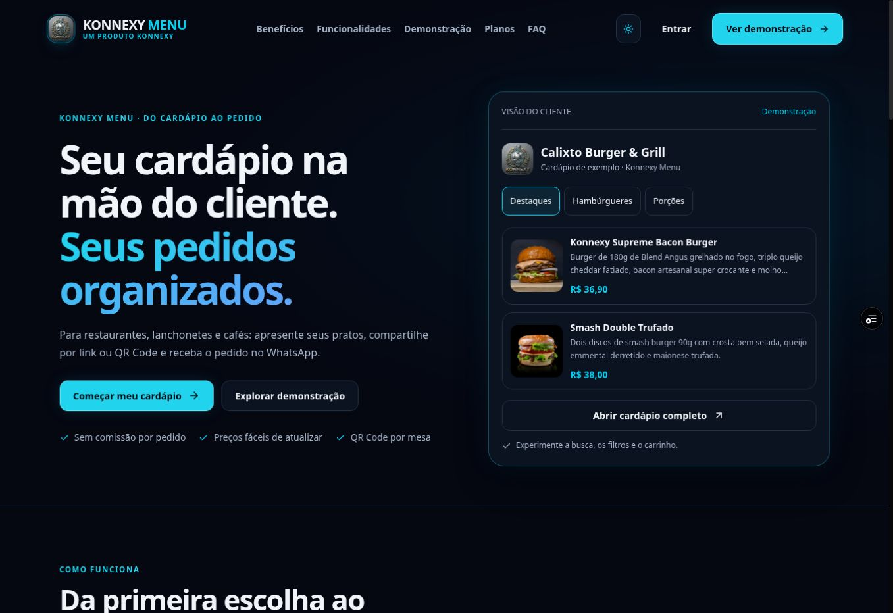

# Revisão Konnexy Menu

Revisão do projeto existente, sem migração de framework ou novas dependências.

## Diagnóstico confirmado

- Hero desproporcional, prévia com controles sem ação e âncora `#beneficios` sem seção correspondente.
- Cores de plataforma inconsistentes, navegação apertada em tablet e campos sem associação entre label e input.
- Modal compartilhado sem contenção de foco e com limitações de altura em telas pequenas.
- Controles de quantidade pequenos; ações do detalhe e formulário de entrega comprimidas em 375px.
- Carregamento do cardápio sem estado de erro recuperável.
- Depoimentos fictícios e promessas de offline/otimização de imagens sem implementação correspondente.
- Referência de favicon inexistente e restrição de zoom na viewport.

## Implementação

- Plataforma navy com ciano/azul, bordas luminosas discretas e tema claro com contraste ajustado.
- Home com benefício, público, ações de cadastro/demonstração, prévia filtrável, etapas e recursos em 2 × 2.
- Identidade dos estabelecimentos preservada no cardápio público.
- Containers, grids, navegação mobile/tablet, formulários, tabelas e estados vazios revisados.
- Modal nativo com Escape, foco, rolagem interna e safe-area; botões de quantidade de 44px.
- Labels conectadas, estados selecionados expostos, foco visível e reduced motion via CSS e Framer Motion existente.
- Busca com limpeza de filtros, carregamento paralelo de categorias/produtos e feedback após 15 segundos de espera. Respostas tardias válidas ainda são aceitas.
- Imagens, logo, rotas, APIs, serviços de dados e regras de negócio existentes mantidos.

## Verificação executada

| Verificação | Resultado |
| --- | --- |
| Build Next.js e tipos | Aprovado localmente e no preview Vercel |
| `git diff --check` | Aprovado |
| Home em 375, 768, 1024, 1440px | Sem overflow horizontal medido |
| Cardápio com dados de exemplo nas quatro larguras | Sem overflow horizontal medido |
| Login em 375px | Formulário legível e sem overflow |
| Menu mobile, âncora de planos, alternância mensal/anual, FAQ | Funcionando |
| Filtro da prévia e tema claro/escuro | Funcionando |
| Busca inexistente e limpeza de filtros | Estado vazio e recuperação funcionando |
| Modal por teclado | Escape fecha e devolve foco ao produto |
| Quantidades, observações e carrinho | 2 × 36,90 = 73,80; redução para 1 recalcula 36,90; observação mantida |
| Delivery em 375px | Labels acessíveis; corpo do modal 295px sem overflow |
| Banco real, autenticação e pedidos enviados | Validação específica pendente; não confundir testes com mocks com integração |

Os testes responsivos usaram iframes de larguras exatas em um ambiente temporário com HTML/JS compilados do projeto. Para o cardápio, uma cópia isolada renderizou o componente real com os dados de exemplo existentes, sem credenciais de produção. Nenhum pedido ou mensagem foi enviado.

## Performance e limites

- Nenhuma dependência adicionada; reutilizados Framer Motion, Lucide e demais pacotes existentes.
- First Load JS da home: aproximadamente 157 kB; compartilhado: 102 kB no build local.
- Houve avisos de restauração de cache webpack em um build local; a compilação concluiu com sucesso.
- Lighthouse não foi executado; não há nota de performance certificada.
- Painéis autenticados, pagamentos, webhooks, RLS e gravação de pedidos não foram certificados por testes de ponta a ponta.
- A implementação anterior de autenticação permite fallback local; a entrada master contém controle no cliente. Esses riscos já existentes exigem revisão específica de segurança e não foram alterados nesta revisão visual.

## Disponibilidade do ambiente

O build público aponta para o projeto Supabase `eqmrkhjodkhorbjuqkmq` (konnexy menu). Na investigação ele estava `INACTIVE`. A retomada do mesmo projeto foi solicitada com sucesso, sem migrações ou alteração de dados. A validação da integração depende de o serviço concluir a inicialização.

## Registro visual

